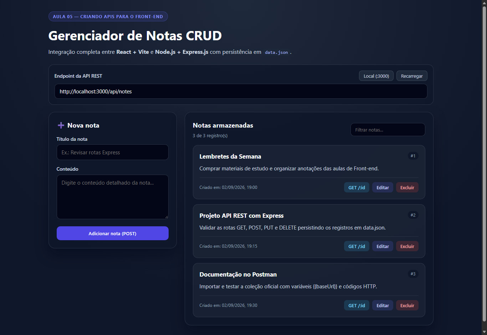

# 📝 Notes CRUD Fullstack — React + Node.js/Express

Aplicação completa de gerenciamento de notas (**CRUD**: *Create, Read, Update, Delete*) desenvolvida na **Aula 05 (Criando APIs para o Front-end)** da disciplina de **Frameworks Front-end** (SENAI).

---

## 📸 Captura de Tela da Aplicação em Funcionamento



---

## 🎯 Descrição da Atividade

Evoluir o servidor **Node.js + Express.js** para implementar uma API RESTful completa com persistência em arquivo **JSON** (`data.json`), conectá-la a uma aplicação Front-end em **React + Vite** realizando todas as operações CRUD e documentar os endpoints utilizando uma coleção estruturada no **Postman**.

---

## ✨ Funcionalidades Implementadas

- **Create (`POST /api/notes`):** Criação de notas por formulário controlado com validação obrigatória de título e conteúdo;
- **Read (`GET /api/notes`):** Listagem reativa das notas armazenadas em `data.json`, com busca em tempo real e contador de registros;
- **Read por ID (`GET /api/notes/:id`):** Inspeção individual do JSON completo da nota em modal dedicado;
- **Update (`PUT /api/notes/:id`):** Edição de notas existentes com atualização automática do registro e timestamp `atualizadoEm`;
- **Delete (`DELETE /api/notes/:id`):** Exclusão segura com confirmação do usuário;
- **Configuração dinâmica de Endpoint:** Alternância imediata entre `http://localhost:3000/api/notes` e URL pública no **Render**;
- **Coleção Postman incluída:** Arquivo importável documentando parâmetros, exemplos de body e códigos HTTP.

---

## 🛠️ Tecnologias Utilizadas

- **Front-end:** React 19, Vite, JavaScript (ES6+), CSS3 Responsivo, Fetch API
- **Back-end:** Node.js, Express.js, Body-Parser, CORS, File System (`fs`)
- **Persistência & Testes de API:** JSON (`data.json`), Postman Collection v2.1
- **Infraestrutura de Deploy:** Render (`render.yaml`) e Vercel (`frontend/vercel.json`)

---

## 📁 Estrutura de Diretórios

```text
notes-crud-fullstack/
├── backend/
│   ├── data.json            # Armazenamento em JSON das notas
│   ├── package.json
│   └── server.js            # Servidor Express com rotas CRUD completas
├── frontend/
│   ├── src/
│   │   ├── App.jsx          # Interface React consumindo todas as rotas CRUD
│   │   ├── App.css          # Layout responsivo moderno
│   │   └── main.jsx
│   ├── .env.example         # Variável VITE_API_URL para deploy
│   ├── package.json
│   ├── vercel.json          # Rewrites para deploy na Vercel
│   └── vite.config.js
├── docs/
│   └── screenshot-notes-crud.png
├── postman/
│   └── Notes-CRUD-API.postman_collection.json
├── render.yaml              # Configuração de deploy do Back-end no Render
└── README.md
```

---

## 🔗 Documentação da API REST

| Método | Endpoint | Parâmetros / Corpo (JSON) | Resposta de Sucesso | Possível Erro |
|---|---|---|---|---|
| `GET` | `/api/notes` | — | `200 OK` — Array de notas | — |
| `GET` | `/api/notes/:id` | Rota `:id` | `200 OK` — Objeto da nota | `404` Nota não encontrada |
| `POST` | `/api/notes` | `{ "titulo": "...", "texto": "..." }` | `201 Created` — Nota criada com `id` e `criadoEm` | `400` Campos obrigatórios |
| `PUT` | `/api/notes/:id` | Rota `:id` + `{ "titulo": "...", "texto": "..." }` | `200 OK` — Nota atualizada | `400` / `404` Não encontrada |
| `DELETE` | `/api/notes/:id` | Rota `:id` | `200 OK` — `{ "mensagem": "Nota removida" }` | `404` Nota não encontrada |

---

## 📮 Coleção do Postman

O arquivo [`postman/Notes-CRUD-API.postman_collection.json`](./postman/Notes-CRUD-API.postman_collection.json) documenta as operações CRUD com variáveis `{{baseUrl}}` e `{{noteId}}`, exemplos de payload e códigos de status HTTP.

1. Abra o **Postman** e clique em **Import**;
2. Selecione `postman/Notes-CRUD-API.postman_collection.json`;
3. Defina `baseUrl` como `http://localhost:3000` (ou a URL publicada no Render) e execute as requisições.

---

## 🚀 Instruções de Instalação e Execução

### 1. Iniciar o Back-end (Express.js)

```bash
cd backend
npm install
node server.js
```

O servidor iniciará em `http://localhost:3000`.

### 2. Iniciar o Front-end (React + Vite)

Em outro terminal:

```bash
cd frontend
npm install
npm run dev
```

Acesse `http://localhost:5173`.

---

## 💡 Síntese das Questões para Refletir (Aula 05)

1. **Riscos de segurança e mitigação:** APIs abertas sem autenticação, *rate limiting* e com CORS irrestrito (`*`) ficam vulneráveis a abusos. Mitiga-se restringindo origens no CORS, validando payloads (Zod/Joi), usando `helmet` e autenticação JWT.
2. **Uso de `data.json` em produção:** Adequado apenas para estudo e prototipação; em containers efêmeros (como planos gratuitos em nuvem), o sistema de arquivos reinicia a cada novo deploy e não oferece transações ACID.
3. **Escala para 10.000 registros:** Leituras e gravações síncronas (`fs.readFileSync` / `fs.writeFileSync`) bloqueiam o *Event Loop* do Node.js e geram condições de corrida sob acessos concorrentes, exigindo migração para SGBDs como PostgreSQL ou MongoDB.
4. **Organização além de um único `server.js`:** Dividir responsabilidades em `routes/`, `controllers/`, `services/` e `repositories/` facilita testes, manutenção e evolução.

---

## 🎓 Disciplina

**Frameworks Front-end** — Curso Superior de Tecnologia em Análise e Desenvolvimento de Sistemas (SENAI)  
**Professor:** Me. Deivison S. Takatu
